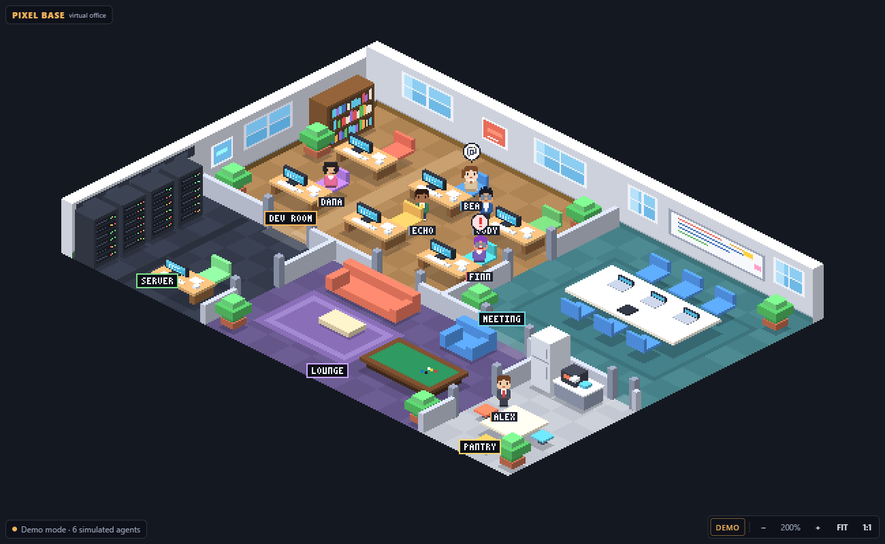
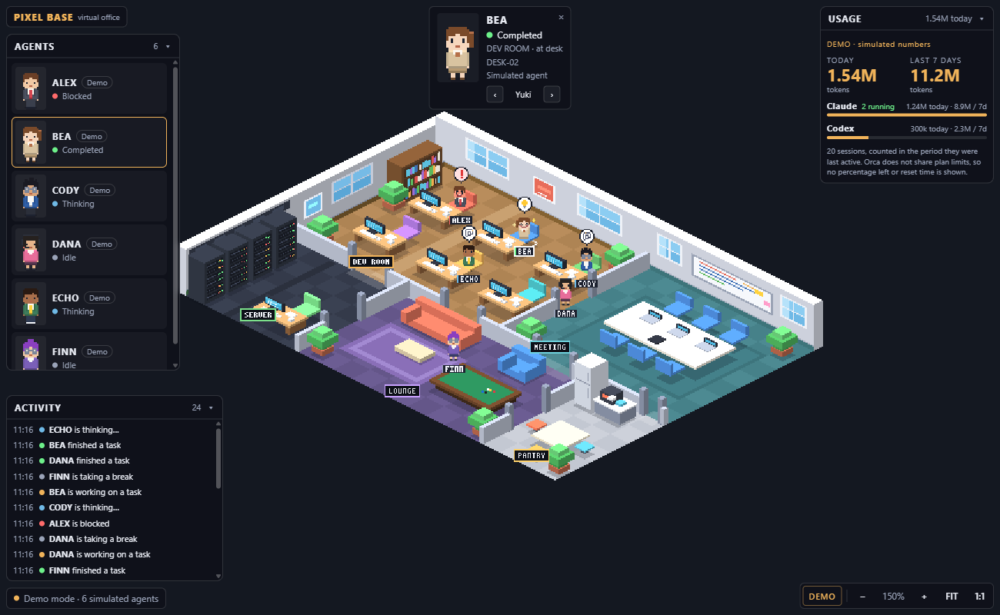

# Pixel Base

**A living pixel-art office for your AI agents.** Pixel Base is an [Orca](https://github.com/stablyai/orca) plugin that shows the agents running in Orca as little office workers in an isometric pixel-art office: they sit at desks while they work, raise a `?` when they wait for you, shout `!` when they are blocked, and wander off to the lounge when they are idle.



*Demo mode (simulated agents and simulated usage numbers). Inside Orca the characters and the numbers are your real ones.*

## What you get

- **An isometric office** with five rooms (Dev Room, Meeting, Server, Lounge, Pantry), zoom, pan and fit-to-view.
- **Your real agents.** Every agent Orca reports, from every workspace (bot homes such as a bot's folder included), is a character named after its workspace.
- **Status you can read at a glance** (see the table below).
- **Three foldable docks** around the office: **Agents** (every agent with its kind, state and task, plus your workspaces; click one to show it), **Usage** (your plan limits — percent used and time to reset for the 5-hour and weekly windows, as Orca's own Usage panel shows them — and tokens used today and over the last 7 days per agent kind) and **Activity** (the state changes Orca reported). In a narrow sidebar they start folded to a one-line header that still shows a count.
- **A profile card** when you click a character: Orca's own state and how long it has lasted, the task, a choice of 14 looks (suit, hoodie, lab coat, sweater, safety vest; the look is only a costume, it says nothing about the agent), and two buttons: **Focus terminal** and **Open workspace**.
- **No AI calls and no data collection.** Pixel Base only mirrors what Orca already knows.



*Selecting a character, or its row in Agents, shows its profile. The Focus terminal and Open workspace buttons appear for real agents only.*

## Requirements

- Orca **1.4.259 or newer** (the Windows build 1.4.277 was used for testing).

## Install

```sh
orca plugin install chantawatthanyaphattharin/pixel-base
```

Orca lists exactly what the plugin is allowed to do and asks you to approve it with a fingerprint before anything runs. Read the next section first.

## Permissions, and why

Pixel Base runs a small worker so it can focus terminals, which Orca only lets a worker do. Orca describes this level of access as running "in a separate Node.js process on the Orca host, with your user account's access to that machine", so you should know exactly what this plugin does with it.

| Capability | Why Pixel Base needs it | What it actually does |
| --- | --- | --- |
| `workspace:read` | Know which workspaces exist | Reads workspace names and branch names. |
| `agent:read` | Show your agents | Reads each agent's state, kind, title, task and terminal id, and listens for status changes. |
| `workspace:write` | The buttons on the profile card and the workspace list | Calls `terminal.focus` (show an agent's terminal) and `workspace.open` (show a workspace). Nothing else. |
| `history:read` | The Usage dock | Calls `agent.listSessions` and adds up each session's token count. Orca's answer also contains each session's title, which is often the start of your first message; the worker throws titles, workspaces and branches away and sends the panel only totals per agent kind. |

The plugin also listens to two things Orca offers a worker without a capability of its own: the `agent.tool.after` hook (every finished tool call of an agent running in an Orca terminal; observe only) and the `agent.status.changed` event. They feed the message above a character's head (next section). The worker keeps only counts from them and never stores, logs or sends a path, a command or any output.

The worker ([`src/worker.ts`](src/worker.ts)) contains six handlers: list workspaces, what each agent's last run did, read plan limits, add up token usage, focus a terminal and open a workspace. It never types into a terminal, never starts, stops or resumes an agent, and never changes a workspace. `workspace:write` allows more than that (for example renaming a workspace) but this plugin does not use it. Nothing is sent anywhere: the panel has no network access and the worker makes no requests. The code is short on purpose so you can read all of it.

**One thing that is not a listed permission:** to read your plan limits the worker runs Orca's own command-line tool, `orca account list --json`, the same command you could type in a terminal. This works because a worker is a normal program on your computer, so it needs no capability and Orca's approval text does not list it. It is the only command Pixel Base runs (fixed arguments, no shell, 8 s timeout). Its answer also lists your agent accounts' emails; the worker throws all of that away and sends the panel only percentages, reset times and the plan name. Pixel Base does not read your Claude or Codex login and makes no request to any provider.

## What the characters show

| You see | Orca reported | Notes |
| --- | --- | --- |
| Sitting at a desk, typing | `working` | |
| `?` bubble, worried face | `waiting` | The agent is waiting for you. |
| `!` bubble, angry face | `blocked` | |
| Light bulb, sparkles | `done` | Shown for a few seconds. |
| Music note, jumping, confetti | `done` with a clean outcome | Illustrative, shown right after the light bulb. |
| Crying | `done` with outcome `failure` | |
| Standing in the lounge, pantry or server room | idle (`done` for a while) | Idle agents leave their desk. |
| Sprout bubble | an agent the panel has just started showing | For its first few seconds (every agent gets one when the panel opens). |

Only working, waiting, blocked and done come from Orca. The light bulb, celebration, crying and idle poses are derived from `done` and are for fun, not extra facts. Pixel Base never invents an agent: the office is empty when Orca reports none.

## The message above a character's head

When an agent finishes a run, a small card appears above its character (above the icon bubble, which is unchanged):

| Card | When | Stays |
| --- | --- | --- |
| **Done.** 14 files, ✓ tests pass | the run changed files, and a test run ended with a pass | 90 s |
| **Done.** 3 files, ✗ tests fail | files changed and the last test run failed | 90 s |
| **Done.** 5 files | files changed, no recognised test run | 90 s |
| **Failed.** 2 files | Orca reported the run as failed | 90 s |
| Done · read 6 files · 21s (quiet grey card) | no files changed: a question, or only reading | 20 s |
| nothing | cancelled or interrupted runs, replies under 3 s | |

What it counts, and what it does not:

- A **file** is a distinct file the run wrote or edited: through Claude Code's Write, Edit, MultiEdit and NotebookEdit tools, or reported by Orca as changed by a shell command (`bashEditDiff`). Files changed in any other way are not counted.
- **Tests pass / fail** is shown only when a shell command looks like a test run (`npm test`, `node --test`, `pytest`, `vitest`, `jest`, `cargo test`, `go test`, `dotnet test`, ...) **and** its output ends with that runner's own summary line. Orca's hook gives no exit code and guessing from words like "fail" proved wrong in practice, so an unknown format shows nothing about tests rather than a guess. The last test run of a run counts.
- **Duration** is from the first time Pixel Base saw the agent start working to the time it finished; it is left out when Pixel Base did not see the start.
- The card **never says what the agent said or did** beyond these counts.
- It needs Orca's tool hook, which only covers **agents running in an Orca terminal** (Claude Code was checked; other agents may report different tool names and show no file count) and not agents on SSH or WSL hosts. Chat-mode agents get the quiet card (duration only) when Orca reports their start and end.
- The counts live in the worker's memory. Orca may stop an idle worker, which forgets runs in progress; a run that was lost shows no card instead of a wrong one. In a development folder, any file change inside it makes Orca reload the worker, so keep test files out of it.

## Using it

- Open the **Pixel Base** panel in Orca's right sidebar. Drag to pan, scroll or use `+` / `-` to zoom, `0` or **FIT** to fit the office, **1:1** for actual size.
- Click a character, or its row in **Agents**, to open its profile. `Esc` closes it. Click a dock's header to fold or unfold it (Pixel Base remembers your choice when the panel allows it). **FIT** and `0` re-centre the office between the open docks.
- **DEMO** shows six simulated agents. It is on automatically when the panel is opened outside Orca, and off inside Orca.
- The status line (bottom left) says what is happening: `Live · 2 workspaces · 3 agents`, or what went wrong, for example `Can't read agents · capability_denied`.

## Usage: plan limits and tokens

The Usage dock has two separate parts. Do not mix them up: they measure different things.

**Plan limits** are the numbers on Orca's own Usage panel: for each signed-in agent account (Claude, Codex and the others Orca can read), the percent of the **5-hour** and **weekly** windows used and how long until each resets, plus the plan name. The header of the folded dock shows them as `5h 16% · wk 18%`. They come from `orca account list --json` (see above) and refresh every minute; Orca decides how often its own numbers update. If Orca's command-line tool cannot be found or does not answer, the dock says so instead of showing anything. It looks for `orca` next to the running Orca (and on `PATH`), and has only been checked on Windows.

**Tokens used on this computer** come from Orca's Agent Session History: today (since local midnight, plus any session still running) and the last 7 days, for the 200 most recent sessions Orca returns. They are a count, not a share of your plan, and the figure may include cached tokens. A session's whole token count is counted in the period of its last activity, so a long session that ran across midnight lands entirely in the day it last moved. If Orca returns more than 200 sessions inside the week, the dock says the numbers are partial.

If the dock says it needs `history:read`, approve the permission in Orca and reload the plugin (plugins that were installed before this version are asked again when they update).

## Limits

- The office has **6 desks**. When more agents are active, the ones that are busy take desks from the ones that have been idle longest; extra agents are counted in the status line (`N without a desk`).
- Up to 20 workspaces are read.
- Focus terminal needs Orca to report a terminal for the agent; otherwise the button is disabled.
- Resume session and Stop are not offered in this version. Resuming needs an extra capability (`agent:launch`) and the agents shown here are live ones; stopping would need Orca to expose a safe way to do it.
- Agents are read through Orca's plugin API, so only agents Orca itself tracks appear.

## Develop

```sh
npm install
npm run build          # bundles src/ into panel/index.html (committed: it is what Orca loads)
npm run typecheck
orca plugin validate .
orca plugin test .     # unit tests for the worker, over Orca's mock host
orca plugin dev watch . # load this folder into Orca; it reloads on every change
npm run serve          # plain-browser preview at http://localhost:5173 (demo mode)
```

Add `?debug` to the preview URL to get `window.pixelBase`, a test hook that lets you advance the simulation by hand and inject a fake Orca host.

```
src/
  main.ts      panel entry: camera, input, profile card, live/demo switch
  scene.ts     the isometric office and its furniture sprites
  character.ts pixel characters, expressions and bubbles
  sim.ts       agent behaviour (sitting, walking, idling)   nav.ts   path finding
  feed.ts      reads agents from Orca (agents.list + events) and logs state changes
  docks.ts     the Agents, Usage and Activity docks
  usage.ts     plan limit and token usage types, parsing and formatting
  worker.ts    the plugin worker (list workspaces, plan limits, token usage, focus terminal, open workspace)
  rooms.ts     room, desk and hang-out layout
```

Orca names a plugin's publisher after the GitHub owner of the repository it is installed from, so this plugin installs as `chantawatthanyaphattharin.pixel-base`. (The GitHub account used to be called `chantawat741` and the repository `isometric-pixel-art`; releases up to 0.2.1 were published under those names and installed as `chantawat741.pixel-base`. Both old addresses redirect to this repository.) See the [Orca plugin authoring guide](https://github.com/stablyai/orca/blob/main/docs/reference/plugin-authoring.md).

## License

[MIT](LICENSE)
